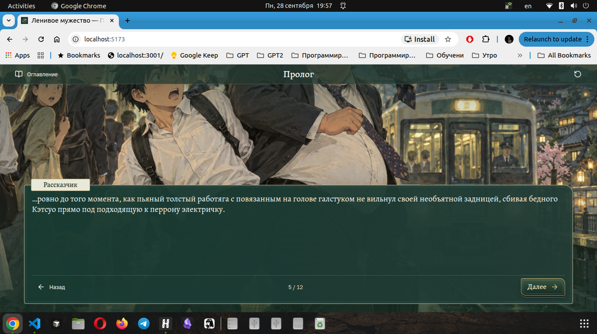

> Исторический документ. Может содержать уже исправленные ошибки и отменённые решения. Действующие правила — [AGENTS.md](../../AGENTS.md), актуальные планы — [здесь](../plans/improvements.md).

Глава 2: реализована целиком — цедулис, инвентарь, сюжетные меню и карта, уровни NPC, уведомление о достижении, учебные бои и пять кроликов с добычей и лечением. Точные книжные числа и постановочные допущения описаны в `docs/chapters/chapter-02.md`.

сейчас оставить стек, выделить отображение боя из App.tsx и устранить ручное согласование длительностей. Если следующий этап — существенно более живая боевая сцена, переносить только поле боя в Phaser, сохранив React для текста, журнала и меню, а XState — для правил и прохождения. Такое сочетание поддерживается официальными шаблонами Phaser.

Выполнено: боевые пузыри используют общий SpeechBubble — привязка указателя к персонажу, ширина по тексту, ограничения экрана и свободное верхнее меню. Правила добавлены в AGENTS.md.

!В фазе графической новеллы - сейчас текст не на всю ширину контейнера. Правый угол занимает внизу кнопка "Далее" и текст не пишется непосредственно над ней

Я давал задание - писать прямую речь одним шрифтом, а остальной текст - другим. Я имел в виду так же те моменты - когда Персонаж что то говорит, затем добавляет чтото автор, а затем прямая речь продолжается. А сейчас просто разные сообщения разными цветами. Так же это нужно прописать в правила проекта. И шрифты можешь выбрать другие - чтобы визуально они отличались но были гармоничны. Это относится и к тексту в пузырях во время боя

Добавь себе в инструкции - что на мобильных телефонах мы делаем только горизонтальный вариант отображения.
Страница 3 первой главы - Изображение богини меньше чем на предидущей странице и на следующих
8 страница и далее несколько- силуэт богини чуть меньше и чуть левее чем предидущий
13 страница - при анимации богиня чуть перемещается в лево и заваливается вместе с троном на бок

И такое происходит постоянно далее по тексту

Я подозреваю что все эти баги с центровкой богини связаны с тем что она меняет свою позу и иногда выставляет руку иногда ещё что и ширина изображения меняется. Нужно найти и применить способ чтобы такого не происходило. Но если просто центрировать изображения по левому краю или правому или по центру - не пойдёт, потому что центр изображения и центр прошлого изображения изменяются, когда рука выставлена в сторону например. Я подозреваю та же проблема будет когда богиня встаёт с трона. То есть когда изменяестя высота спрайта. Предложи свои варианты решения проблемы, без перегенерации изображений. Но не такое, чтобы ты сравнивал две соседние страницы и в ручную переставлял по пикселям изображение - слишком много токенов уйдёт. Когда поймёшь как это исправить и не повторять - добавь это себе в документацию

Продолжай генерацию первой главы. Можешь переиспользовать уже сгенерированные изображения. Изображение главного героя (но в одежде) у нас есть в 8ой главе. 
И вообще создай или пересобери хранилище, где у нас хранятся все спрайты. У нас будут много персонажей и много анимаций у них и много локаций. Возможно стоит использовать webP или другой формат который занимает меньше места, но я не уверен, что тогда обрезка спрайтлистов на анимации будет нормальной, или может возникнут другие проблемы. Это скорее рекомендация.

Момент с выбором класса. Исправь последнюю уже сделаную анимацию в первой главе согласно промпту и продолжи.
В начале по экрану должны быть раскиданы множество карт. Мы кликаем на одну из них; она приближается, переворачивается лицом к нам и мы читаем название и описание класса как в книге. После определённого момента - как описано в книге она отлеатет. Далее по тексту - Когда по тексту - часть карт исчезает - то и у нас они должны исчезать. Когда по тексту - читаем другую/другие карты - мы видим их перед глазами. Когда по тексту - описание меняется - то оно должно с мягким эффектом изменится и в карте. Так же можешь попробовать далее по книге поискать более точное описание классов, которые упоянуты в этом эпизоде; Когда говорят о трёх картах одновременно - то мы и видим их, с их описаниям. Ах да - не забудь добавить соответсвующее изображение на все эти карты, а не просто текст. Изображение на всю карту, Поверх полупрозрачный прямоугольник в нижней части карты, И поверх прямоугольника текст. Соответсвуй стилю игры. Когда предоставляется выбор из трёх карт - мы сами можем кликнуть на каждую. Но если кликаем, не на ту что выбрана в книге - должна быть фраза типа "Хм, неплохо но не то" - для обоих не тех карт по фразе. Я передал смысл фразы, - а ты придумай формулировки.

Момент выбора внешности героя; должен быть некликабельный интерфейс, как в игре, где по тексту внешний вид меняется по желанию Богини (просто сгенерируй несколько картинок). При создании имени - так же должен быть некликабельный интерфейс - но с анимацией ввода имени. То есть сначала появлестя Пустое поля для ввода имени. А анимация ввода имени происходит в тот момент когда мы долистываем до этого момента в книге.

Зацензурь половой орган героя во время его  появления голым в стиле японской порнухи. Если конечно ты сможешь в принципе сгенерировать подобное.

Замечания:
На узких экранах важные куски изображений обрезаются. Пример - 
